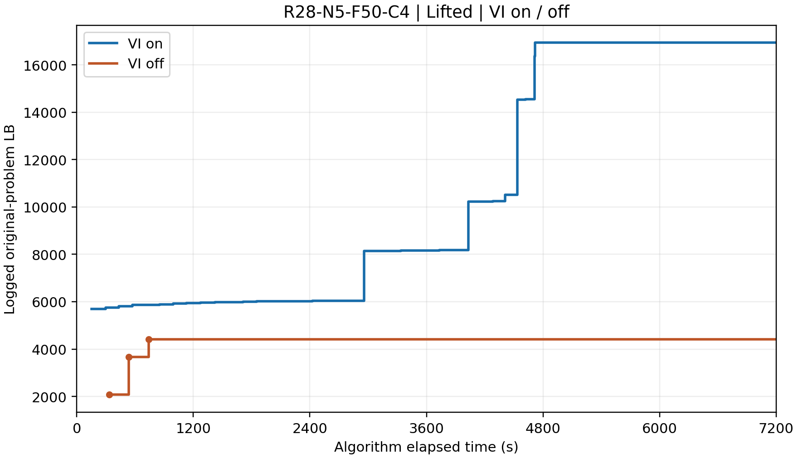

# R28-N5-F50-C4：Lifted VI 开／关

| VI | 最终 LB | UB | actualTime(s) | 算法时间(s) | 完整迭代数 | 状态 |
|---|---:|---:|---:|---:|---:|---|
| 开 | 16934.434787 | ∞ | 7202.031 | 7200.676159 | 291 | TIME_LIMIT |
| 关 | 5089.153366 | ∞ | 7423.172 | 7412.263574 | 3 | TIME_LIMIT |

no-VI 最后完整轮：LB=4416.490878，算法时间 741.909248s。最终 LB=5089.153366 记录于 7412.263574s，不计为 7200s 内的界。

## 同一算法时间的已记录 LB

[数值 CSV](r28_vi_same_algorithm_time_LB.csv) | [PDF](r28_vi_lb_logged_7200.pdf)

[VI 开日志](../logs/R28-N5-F50-C4_lifted-ils.log) | [VI 关日志](../logs/R28-N5-F50-C4_lifted-ils_noVI.log) | [缺失信息](../MISSING.md)
